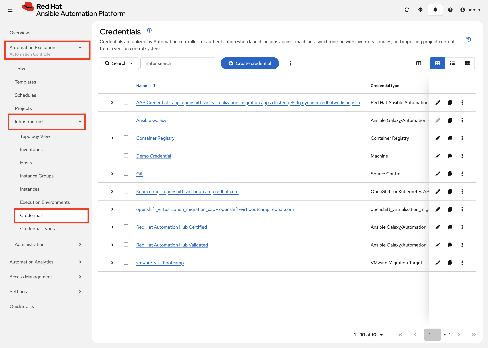
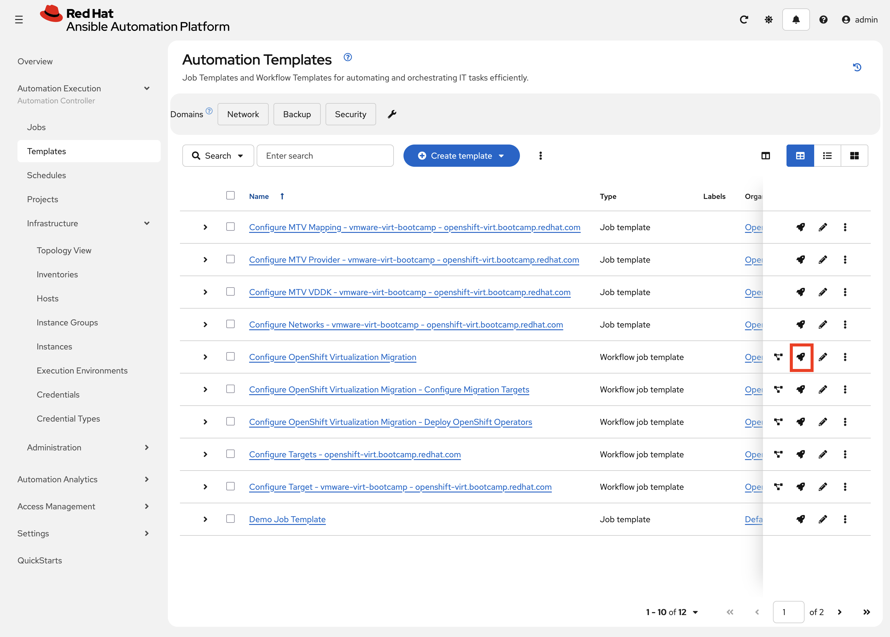
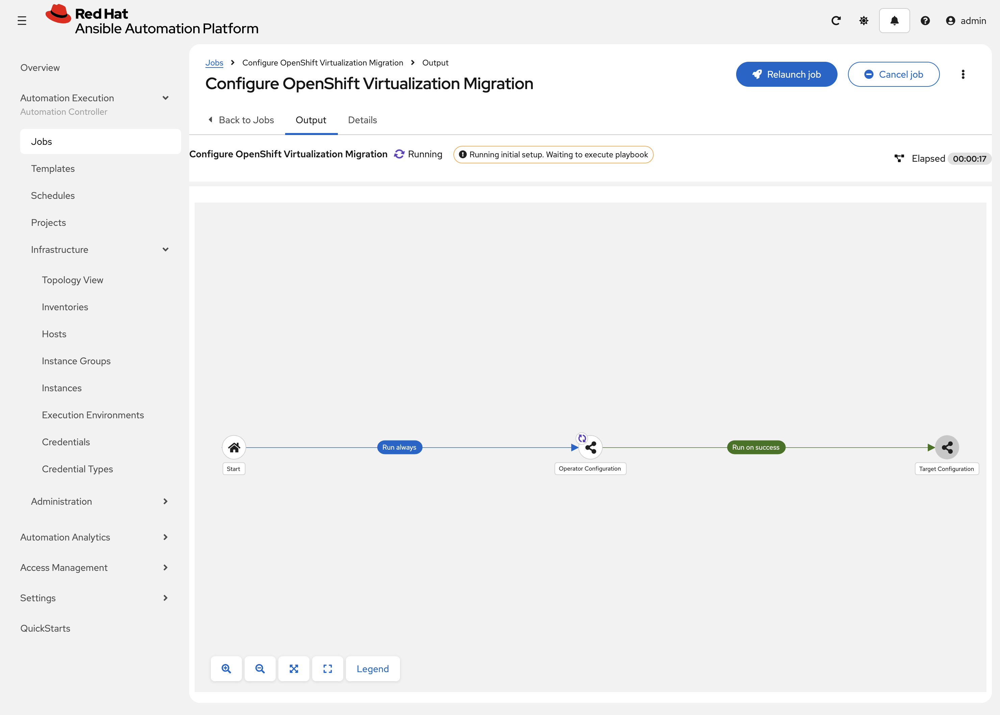
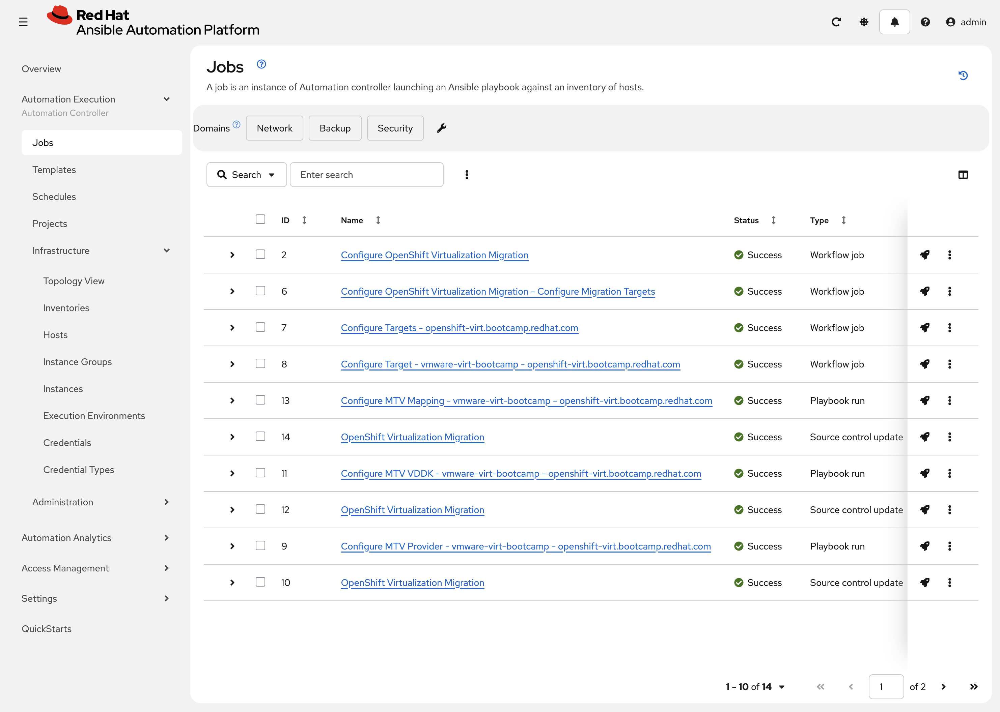
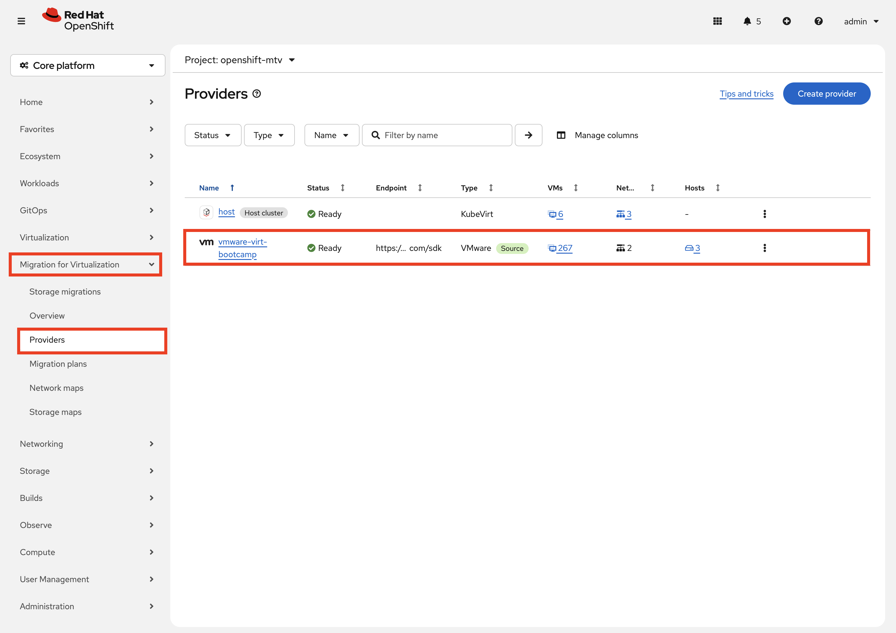
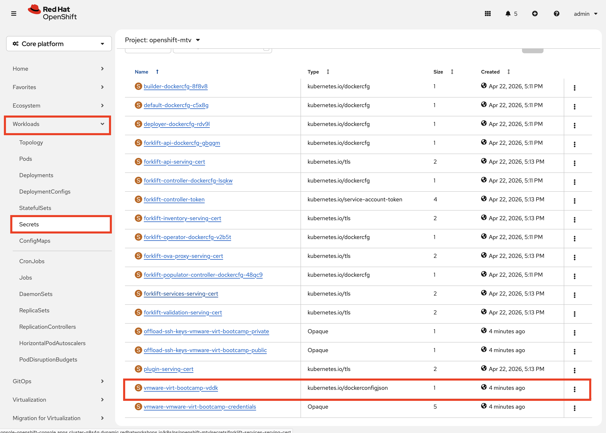
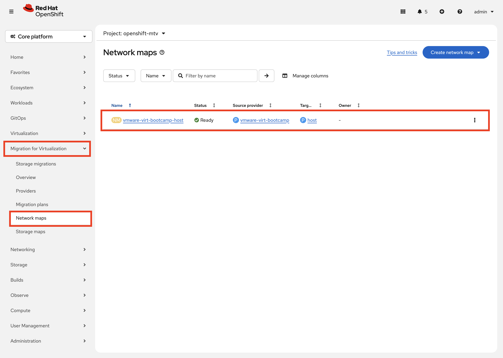
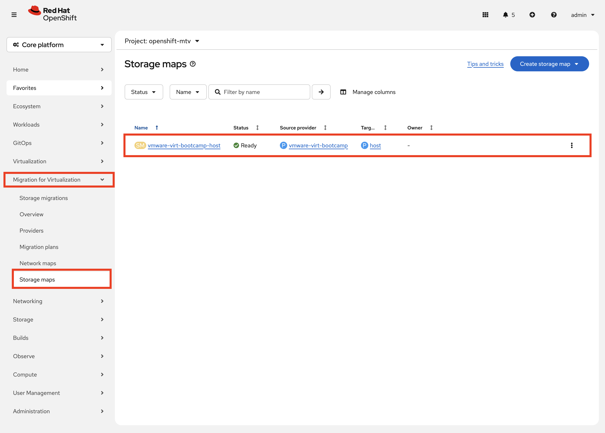

# 01 · Lab 1: install and configure the factory (50 min)

**Goal:** seed your existing AAP with the Migration Factory content, then run one workflow
that configures MTV on your cluster: the VMware provider, the VDDK secret, and the network and
storage maps.

```text
laptop: ansible-navigator ──(oc token, API 6443)──► cluster: service account token for AAP
                          └─(AAP API, 443)────────► AAP: org, project, EE, credentials, templates, workflows
AAP: workflow "Configure OpenShift Virtualization Migration" ──► MTV: provider, VDDK secret, maps
```

> **Where do I run this?** Steps 1–3 run **on your laptop** (Windows: in the **Ubuntu / WSL2
> terminal**; macOS/Linux: a terminal), with the virtual environment activated. Your RHDP
> environment has no terminal for you. Steps 4–5 happen in the **AAP web UI** of your RHDP
> environment.

## Step 1 · Collect your values and log in

Open your RHDP service details page and the **Lab instructions** page, and note the cluster API
URL, the admin password, the *Automation Controller URL* with its admin password, and the vCenter
host, user and password (exact labels in the [README](README.md#where-to-find-your-values)).

Use a **separate kubeconfig** for the lab, so your other cluster logins stay untouched:
```bash
source ~/.virtualenvs/openshift_virt_bootcamp/bin/activate
mkdir -p ~/vmf-lab
export KUBECONFIG=~/vmf-lab/kubeconfig

oc login --insecure-skip-tls-verify=true -u <admin user> -p '<admin password>' <cluster API URL>
oc whoami --show-server        # must print your RHDP cluster API URL
```

> **Which AAP address?** Use **the address of the AAP login page**: on the RHDP details page it's
> labelled **Automation Controller URL** and looks like `https://aap-aap.apps.cluster-xxxxx.dyn.redhatworkshops.io`.
> Since AAP 2.5 this is the *platform gateway*; the controller runs behind it. **Don't** use any
> other AAP route (for example one with `-controller-` in its name). Check that you have the right one:
> ```bash
> curl -sk https://<AAP host>/api/gateway/v1/ping/      # expected: {"status":"good", ...}
> ```

If the AAP URL or password isn't on your RHDP page, find them on the cluster:
```bash
oc get route -A | grep -i -E 'aap|gateway'                  # the AAP login page route
oc get secret -A | grep -i admin-password                   # then: oc extract secret/<name> -n <ns> --to=-
```

## Step 2 · Fill in your inventory

You use **two** inventory files:
- `inventory/inventory-openshift-virt-bootcamp-base.yml`: common settings. **Don't edit.**
- `inventory/inventory-openshift-virt-bootcamp.yml`: your values. Replace every `<...>`.

```bash
cd ~/vmf-bootcamp-day2-lab/inventory
vi inventory-openshift-virt-bootcamp.yml       # or nano, or any editor
```

You fill in only these lines; **paste the URLs exactly as shown** on the RHDP pages (with
`https://` is fine, the file derives the host names itself):

| Line | Value | Example |
|---|---|---|
| `container_username` / `container_password` | quay robot account from the instructor | |
| `vcenter_url` | vCenter link from the Lab instructions page | `https://vcenter.apps.ocpv07.rhdp.net` |
| `vmware_username` / `vmware_password` | vCenter user and password from the Lab instructions page | `user1` |
| `aap_url` | **Automation Controller URL** from the details page (the AAP login page) | `https://aap-aap.apps.cluster-xxxxx.dyn.redhatworkshops.io` |
| `aap_admin_password` | **Automation Controller Admin Password** | |

Don't edit the "derived values" block. It turns your URLs into the host names the factory
needs (`vmware_host`, `controller_hostname`, `aap_hostname`) and reuses the password for both
`controller_password` and `aap_password`.

What the other RHDP-specific lines do:

| Setting | Why |
|---|---|
| `install_aap: false` (host `openshift-virt.bootcamp.redhat.com` in `migration_hub`) | RHDP already has AAP; the factory only seeds it |
| `controller_*` / `aap_*` (derived) | where and how to reach your existing AAP; both point to the same AAP login page host |
| `aap_version: 2.5` | the AAP version in RHDP |
| `aap_project_branch: "1.25.0"` | the AAP Project checks out the collection's release tag, not the moving `main` branch |
| `aap_request_timeout: 60` | gives AAP more time when many objects are created in parallel |
| `insecureSkipTlsVerify: true` (target) | the simulated vCenter has a self-signed certificate |
| `rh_*: notused` | only needed when the factory installs AAP |

> **Note:** the host name `openshift-virt.bootcamp.redhat.com` is only an inventory **label**.
> The real cluster comes from `oc whoami --show-server` in the next step. The label shows up in
> the AAP template names, for example `Configure Target - vmware-virt-bootcamp - openshift-virt.bootcamp.redhat.com`.

## Step 3 · Seed AAP

> **On a corporate laptop or network?** Run this step from a **phone hotspot** (or a home network
> with the VPN and security client off). Corporate networks often cut the seed's HTTPS
> connections (`SSL: UNEXPECTED_EOF_WHILE_READING`). Only this step needs it; afterwards you can
> switch back.

**Before you start, check that AAP is ready and reachable** (fresh RHDP environments sometimes need a
few more minutes, and a not-ready AAP shows up as `TimeoutError: The read operation timed out`):
```bash
grep -E '^ *aap_url:|^ *aap_request_timeout:' inventory-openshift-virt-bootcamp.yml   # both present?
curl -sk https://<AAP host>/api/gateway/v1/ping/       # {"status":"good", ...} quickly (< 2 s)
```
You must also be able to log in to the AAP web UI with the admin password. If the ping is slow,
fails, or the UI doesn't load, wait 5 minutes and try again. If it stays like that, restart the
environment in RHDP (*Stop*, then *Start*) and check again.

Run this from the `inventory` folder:
```bash
cd ~/vmf-bootcamp-day2-lab/inventory

SSH_AUTH_SOCK="" ansible-navigator run \
  --eei=quay.io/redhat-cop/openshift-virtualization-migration-ee:2.6 \
  -m stdout \
  --pp=missing \
  infra.openshift_virtualization_migration.migration_factory_aap \
  -i inventory-openshift-virt-bootcamp-base.yml \
  -i inventory-openshift-virt-bootcamp.yml \
  --pae false \
  -e openshift_host=$(oc whoami --show-server) \
  -e openshift_temporary_api_key=$(oc whoami -t)
```

| Option | Meaning |
|---|---|
| `--eei … --pp=missing` | the execution environment image; pull it only if it's not already local |
| `-m stdout` | print the output to the terminal (no interactive UI) |
| `--pae false` | don't write playbook artefacts (they would contain your passwords) |
| `-e openshift_host / openshift_temporary_api_key` | your cluster and a short-lived token; the playbook creates a long-lived service account token for AAP from it |

It takes about 5–10 minutes (about 6 minutes in our test). The **PLAY RECAP** must show
`failed=0` for both hosts, for example:
```text
aap-aap.apps.cluster-xxxxx.dyn.redhatworkshops.io : ok=171  changed=41  unreachable=0  failed=0  skipped=100 …
openshift-virt.bootcamp.redhat.com                : ok=6    changed=2   unreachable=0  failed=0  skipped=9   …
```
The run is **idempotent**: after a timeout or an error you've fixed, just run it again.

> **Seed failed?** The three most common causes, in this order:
> 1. `SSL: UNEXPECTED_EOF_WHILE_READING`: your **corporate network** (VPN / security client) cuts
>    HTTPS connections. **Switch the laptop to a phone hotspot for this step** and re-run. That fixed
>    it for participants in earlier runs.
> 2. `TimeoutError: The read operation timed out`: AAP not ready yet or overloaded. Check the
>    ping above, then re-run. Make sure `aap_request_timeout: 60` is in your inventory (old copies of
>    the template don't have it).
> 3. `the playbook: … could not be found`: old ansible-navigator
>    ([prerequisites](00-prerequisites.md#version-requirements)).
>
> More in [04 · Troubleshooting](04-troubleshooting.md#lab-1).

## Step 4 · Explore what was seeded in AAP

Log in to the AAP web UI as `admin`.

> Your RHDP environment also contains the demo's **own** templates (*01 Migrate VMware VMs to
> OpenShift Virtualization*, *02 Provision Linux VMs*, …, *Demo Job Template*) in the *Default*
> organization. They're not part of the factory; don't use them in these labs.

1. **Organizations:** a new organization **OpenShift Virtualization Migration** holds everything.

   
2. **Projects:** the Project points to the collection's Git repository, at tag `1.25.0`. AAP runs
   the job templates' playbooks from this checkout.

   
3. **Execution Environments:** **OpenShift Virtualization Migration**, the same EE image you
   pulled, runs every job.

   
4. **Credentials:** among others **Kubeconfig - openshift-virt.bootcamp.redhat.com** (decides which
   cluster a job touches) and **vmware-virt-bootcamp** (the vCenter login).

   
5. **Templates:** job templates and workflows. The suffix `- <target> - <cluster>` tells you which
   source and cluster a template works on.

   

## Step 5 · Run the Configure workflow

1. In **Templates**, launch the workflow **Configure OpenShift Virtualization Migration**
   (rocket icon).

   
2. Watch it in the workflow visualizer:
   ```text
   Deploy OpenShift Operators ──► Configure Migration Targets
     └ Configure Operators - <cluster>        └ Configure Targets - <cluster>
                                                  └ Configure Target - vmware-virt-bootcamp - <cluster>
                                                       MTV Provider ──► MTV VDDK ──► MTV Mapping
   ```
   
   - **Configure Operators** finishes quickly and changes nothing. The operators are
     pre-installed, so the operator lists in the base inventory are empty (`[]`).
   - The optional steps (Networks, VDDK, Mapping) were decided **at seed time** by the
     `network:`, `vddk:` and `mapping:` keys of the target in the inventory. Your target has `vddk`
     and `mapping`, so there's no Networks step.
   - The whole workflow takes about 2–3 minutes.
3. Open **Jobs** to see each job's output.

   

## ✅ Checkpoint

In the OpenShift console, project **openshift-mtv**:

| Check | Where | Expected |
|---|---|---|
| Source provider | Migration for Virtualization → Providers | `vmware-virt-bootcamp` with a green check (Ready) |
| VDDK secret | Workloads → Secrets | `vmware-virt-bootcamp-vddk` |
| Network map | Migration for Virtualization → Network maps | `vmware-virt-bootcamp-host`, Ready |
| Storage map | Migration for Virtualization → Storage maps | `vmware-virt-bootcamp-host`, Ready |






The same checks from the command line:
```bash
oc get providers.forklift.konveyor.io -n openshift-mtv
oc get secret vmware-virt-bootcamp-vddk -n openshift-mtv
oc get networkmap,storagemap -n openshift-mtv
```
Expected output (the providers `host` and `vmware` were already there; `vmware` belongs to the
RHDP demo):
```text
NAME                   TYPE        STATUS   READY   CONNECTED   INVENTORY   URL
host                   openshift   Ready    True    True        True
vmware                 vsphere     Ready    True    True        True        https://vcenter.apps.ocpvNN.rhdp.net/sdk
vmware-virt-bootcamp   vsphere     Ready    True    True        True        https://vcenter.apps.ocpvNN.rhdp.net/sdk
```
The map name `<target>-host` means "from source `vmware-virt-bootcamp` to destination `host`",
where `host` is the cluster itself.

**Workflow failed at "MTV Network and Storage Mapping"** with *"Source Provider with name
'vmware-virt-bootcamp' not found in namespace 'openshift-mtv'"*? The provider was created but MTV
couldn't connect to the vCenter, so it never appeared in MTV's inventory. Check it:
```bash
oc get providers.forklift.konveyor.io vmware-virt-bootcamp -n openshift-mtv \
  -o jsonpath='{range .status.conditions[*]}{.type}={.status} {.message}{"\n"}{end}'
```
- **Ready/ConnectionTestSucceeded = False:** wrong vCenter URL, user or password. Fix `vcenter_url` /
  `vmware_username` / `vmware_password` in your inventory, **re-run step 3** (it updates the AAP
  credential), then relaunch the workflow.
- **Ready = True:** MTV just needed more time to load the inventory. Relaunch the workflow (or only
  *Configure MTV Mapping - vmware-virt-bootcamp - openshift-virt.bootcamp.redhat.com*).

Not green? See [04 · Troubleshooting](04-troubleshooting.md#lab-1).

## Think about it (2 minutes)
- Which of these objects would you have created by hand in the MTV console, and how many times
  with 3 clusters and 2 vCenters?
- What would you change in the inventory to add a second vCenter? (A second `migration_targets`
  entry, then re-seed.)

---
Previous: [00 · Prerequisites](00-prerequisites.md) · Next: [02 · Lab 2: prepare a namespace](02-lab2-prepare-namespace.md)
