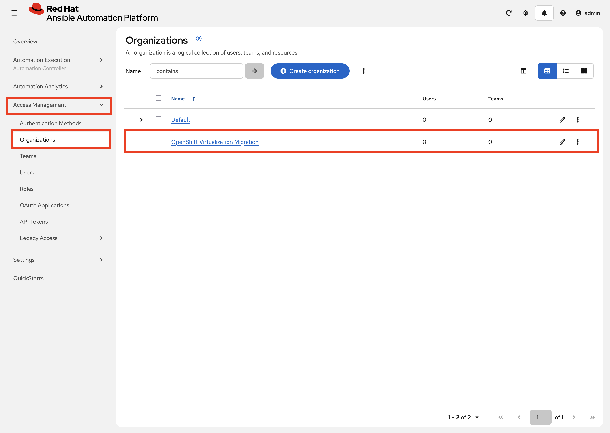
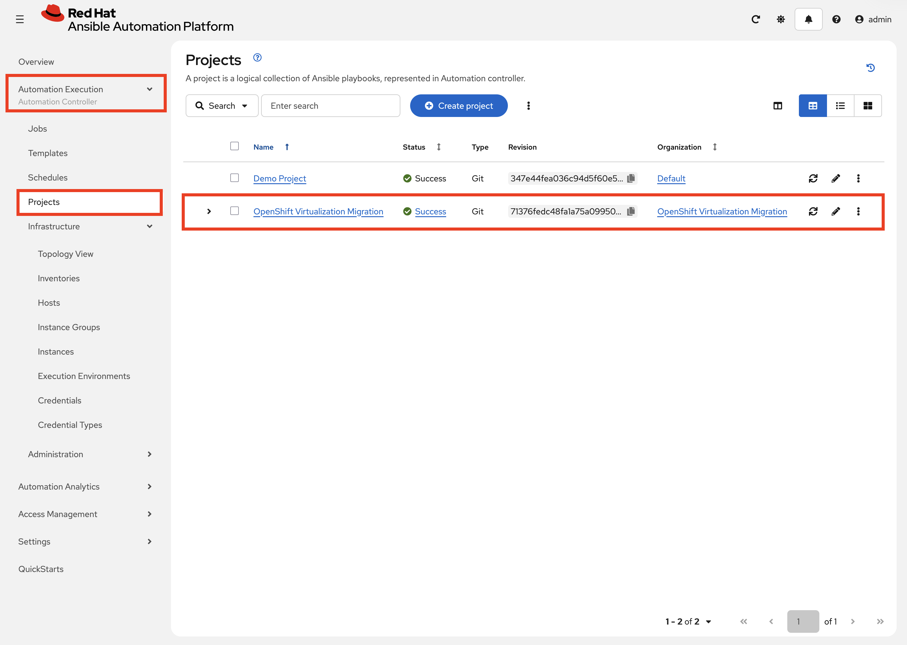
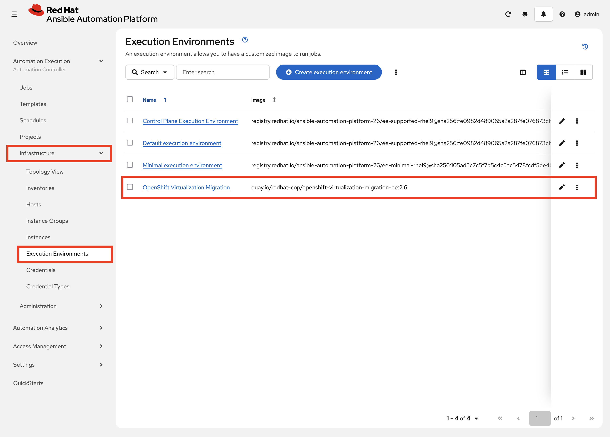
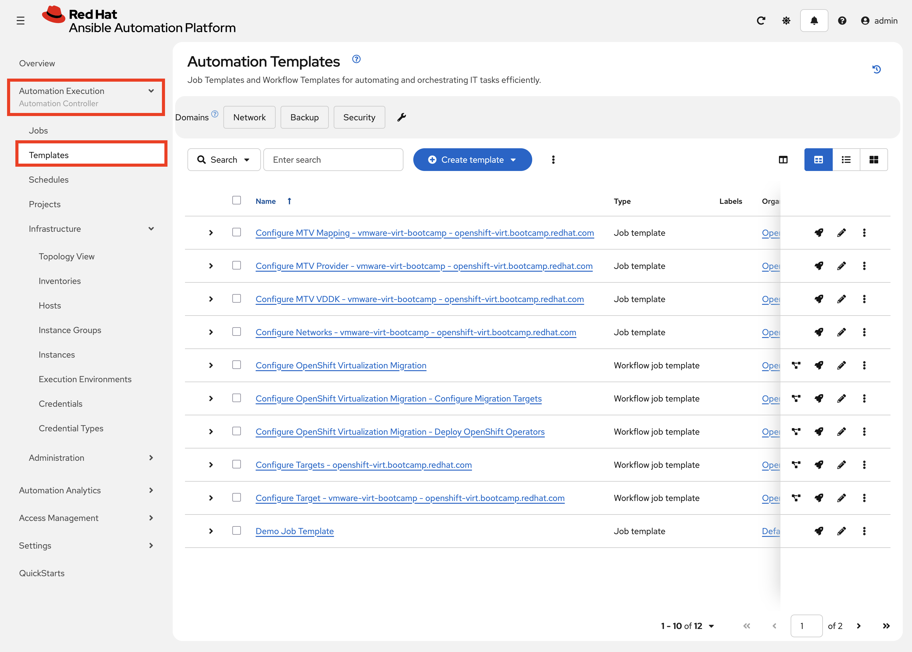

# 01 · Lab 1: install and configure the factory (50 min)

**Goal:** seed your existing AAP with the Migration Factory content, then run one workflow
that configures MTV on your cluster: the VMware provider, the VDDK secret, and the network and
storage maps.

```text
laptop: ansible-navigator ──(oc token, API 6443)──► cluster: service account token for AAP
                          └─(AAP API, 443)────────► AAP: org, project, EE, credentials, templates, workflows
AAP: workflow "Configure OpenShift Virtualization Migration" ──► MTV: provider, VDDK secret, maps
```

## Step 1 · Collect your values and log in

Open your RHDP environment details page and note the cluster API URL, the admin user and
password, the AAP URL with its admin password, and your vCenter host, `userN` and password
(see the [README](README.md#where-to-find-your-values)).

Use a **separate kubeconfig** for the lab, so your other cluster logins stay untouched:
```bash
source ~/.virtualenvs/openshift_virt_bootcamp/bin/activate
mkdir -p ~/vmf-lab
export KUBECONFIG=~/vmf-lab/kubeconfig

oc login --insecure-skip-tls-verify=true -u <admin user> -p '<admin password>' <cluster API URL>
oc whoami --show-server        # must print your RHDP cluster API URL
```

If the AAP URL or password isn't on your RHDP page, find them on the cluster:
```bash
oc get route -A | grep -i -E 'aap|controller|gateway'      # the AAP host name
oc get secret -A | grep -i admin-password                   # then: oc extract secret/<name> -n <ns> --to=-
```

## Step 2 · Fill in your inventory

You use **two** inventory files:
- `inventory/inventory-openshift-virt-bootcamp-base.yml`: common settings. **Don't edit.**
- `inventory/inventory-openshift-virt-bootcamp.yml`: your values. Replace every `<...>`.

```bash
cd ~/vmf-bootcamp-day2-lab/inventory
vi inventory-openshift-virt-bootcamp.yml       # or any editor
```

What the RHDP-specific lines do:

| Setting | Why |
|---|---|
| `install_aap: false` (host `openshift-virt.bootcamp.redhat.com` in `migration_hub`) | RHDP already has AAP; the factory only seeds it |
| `controller_*` / `aap_*` | where and how to reach your existing AAP (host name **without** `https://`) |
| `aap_version: 2.5` | the AAP version in RHDP |
| `aap_project_branch: "1.25.0"` | the AAP Project checks out the collection's release tag, not the moving `main` branch |
| `aap_request_timeout: 60` | gives AAP more time when many objects are created in parallel |
| `insecureSkipTlsVerify: true` (target) | the simulated vCenter has a self-signed certificate |
| `rh_*: notused` | only needed when the factory installs AAP |

> **Note:** the host name `openshift-virt.bootcamp.redhat.com` is only an inventory **label**.
> The real cluster comes from `oc whoami --show-server` in the next step. The label shows up in
> the AAP template names, for example `Configure Target - vmware-virt-bootcamp - openshift-virt.bootcamp.redhat.com`.

## Step 3 · Seed AAP

Run this from the `inventory` folder:
```bash
cd ~/vmf-bootcamp-day2-lab/inventory

SSH_AUTH_SOCK="" ansible-navigator run \
  --eei=quay.io/redhat-cop/openshift-virtualization-migration-ee:2.6 \
  -m stdout \
  --pp=missing \
  infra.openshift_virtualization_migration.migration_factory_aap \
  -i inventory-openshift-virt-bootcamp-base.yml \
  -i inventory-openshift-virt-bootcamp.yml \
  --pae false \
  -e openshift_host=$(oc whoami --show-server) \
  -e openshift_temporary_api_key=$(oc whoami -t)
```

| Option | Meaning |
|---|---|
| `--eei … --pp=missing` | the execution environment image; pull it only if it's not already local |
| `-m stdout` | print the output to the terminal (no interactive UI) |
| `--pae false` | don't write playbook artefacts (they would contain your passwords) |
| `-e openshift_host / openshift_temporary_api_key` | your cluster and a short-lived token; the playbook creates a long-lived service account token for AAP from it |

It takes about 5–10 minutes. The **PLAY RECAP** must show `failed=0` for every host. The run is
**idempotent**: after a timeout or an error you've fixed, just run it again.

## Step 4 · Explore what was seeded in AAP

Log in to the AAP web UI as `admin`.

1. **Organizations:** a new organization **OpenShift Virtualization Migration** holds everything.

   
2. **Projects:** the Project points to the collection's Git repository, at tag `1.25.0`. AAP runs
   the job templates' playbooks from this checkout.

   
3. **Execution Environments:** **OpenShift Virtualization Migration**, the same EE image you
   pulled, runs every job.

   
4. **Credentials:** among others **Kubeconfig - openshift-virt.bootcamp.redhat.com** (decides which
   cluster a job touches) and **vmware-virt-bootcamp** (the vCenter login).

   
5. **Templates:** job templates and workflows. The suffix `- <target> - <cluster>` tells you which
   source and cluster a template works on.

   

## Step 5 · Run the Configure workflow

1. In **Templates**, launch the workflow **Configure OpenShift Virtualization Migration**
   (rocket icon).

   
2. Watch it in the workflow visualizer:
   ```text
   Deploy OpenShift Operators ──► Configure Migration Targets
     └ Configure Operators - <cluster>        └ Configure Targets - <cluster>
                                                  └ Configure Target - vmware-virt-bootcamp - <cluster>
                                                       MTV Provider ──► MTV VDDK ──► MTV Mapping
   ```
   
   - **Configure Operators** finishes quickly and changes nothing. The operators are
     pre-installed, so the operator lists in the base inventory are empty (`[]`).
   - The optional steps (Networks, VDDK, Mapping) were decided **at seed time** by the
     `network:`, `vddk:` and `mapping:` keys of the target in the inventory. Your target has `vddk`
     and `mapping`, so there's no Networks step.
3. Open **Jobs** to see each job's output.

   

## ✅ Checkpoint

In the OpenShift console, project **openshift-mtv**:

| Check | Where | Expected |
|---|---|---|
| Source provider | Migration for Virtualization → Providers | `vmware-virt-bootcamp` with a green check (Ready) |
| VDDK secret | Workloads → Secrets | `vmware-virt-bootcamp-vddk` |
| Network map | Migration for Virtualization → Network maps | `vmware-virt-bootcamp-host`, Ready |
| Storage map | Migration for Virtualization → Storage maps | `vmware-virt-bootcamp-host`, Ready |


The same checks from the command line:
```bash
oc get providers.forklift.konveyor.io -n openshift-mtv
oc get secret vmware-virt-bootcamp-vddk -n openshift-mtv
oc get networkmap,storagemap -n openshift-mtv
```
The map name `<target>-host` means "from source `vmware-virt-bootcamp` to destination `host`",
where `host` is the cluster itself.

Not green? See [04 · Troubleshooting](04-troubleshooting.md#lab-1).

## Think about it (2 minutes)
- Which of these objects would you have created by hand in the MTV console, and how many times
  with 3 clusters and 2 vCenters?
- What would you change in the inventory to add a second vCenter? (A second `migration_targets`
  entry, then re-seed.)

---
Previous: [00 · Prerequisites](00-prerequisites.md) · Next: [02 · Lab 2: prepare a namespace](02-lab2-prepare-namespace.md)
