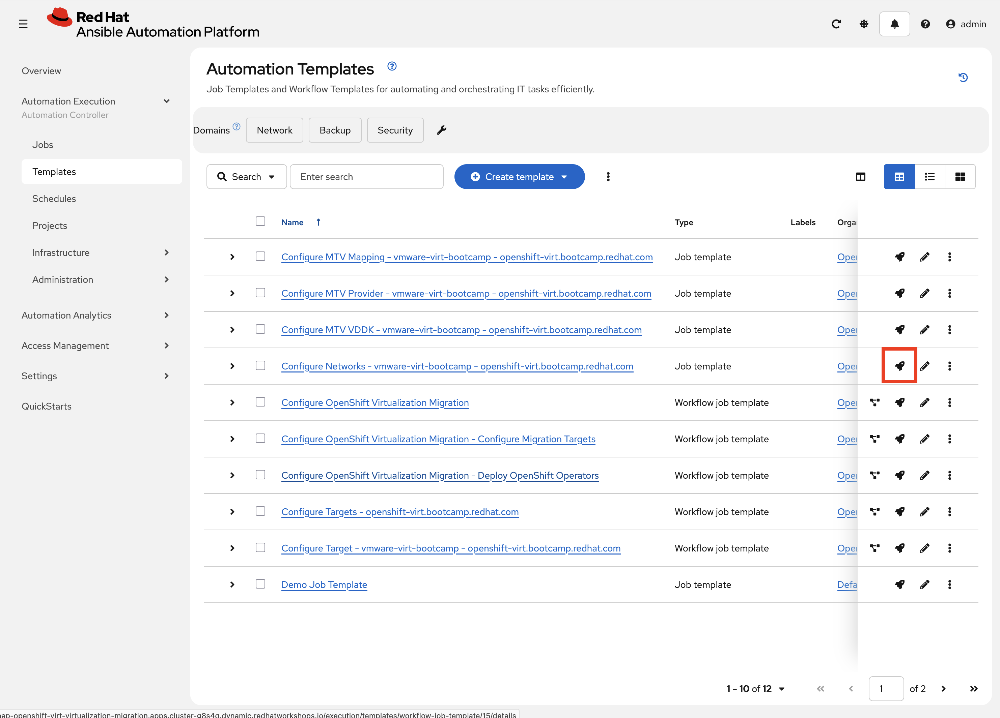
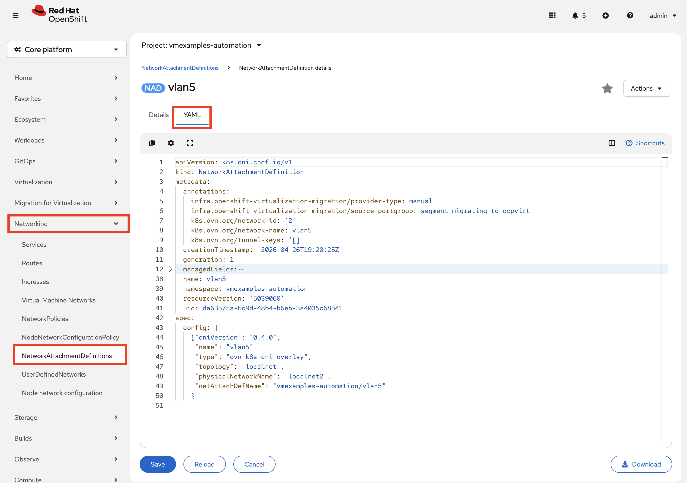

# 02 · Lab 2: prepare a namespace for migration (30 min)

**Goal:** prepare a new application namespace, `vmexamples-automation`, as a migration
destination. Each application team usually gets its own namespace, and every namespace needs
its **own** VDDK secret, network map and storage map.

```text
1. create the namespace            (Platform team; the factory doesn't create namespaces)
2. Configure Networks  [optional]  NADs for the port groups the VMs use
3. Configure Target                VDDK secret + NetworkMap + StorageMap in the namespace
```

## Step 1 · Create the namespace

Console: **Home → Projects → Create Project**, name `vmexamples-automation`. Or from the command line:
```bash
oc new-project vmexamples-automation
```


> **Why first?** No factory template creates namespaces. If the namespace doesn't exist,
> Configure Networks and Configure Target fail on their first object.

## Step 2 · (Optional) Configure Networks

**Do this step only if your instructor gives you a localnet name for your environment.**
Otherwise skip it; your VMs map to the pod network, which is fine for this lab.

The job template **Configure Networks - vmware-virt-bootcamp - openshift-virt.bootcamp.redhat.com**
creates NetworkAttachmentDefinitions (NADs) and labels each one with the vSphere port group it
represents. Launch it and enter these **Variables**:
```yaml
network_mgmt_manual_localnet_name: <localnet name from the instructor>
network_mgmt_openshift_network_bridge_mode: ovs-bridge
network_mgmt_manual_nad_list:
  - name: <nad name, e.g. vm-network>
    portgroup: <exact vSphere port group name>     # case-sensitive
    namespace: default                             # shared NAD, usable from every namespace
    trunk: false
    vlan:
      vlan_id: 0                                   # 0 = untagged
```



The NAD appears under **Networking → NetworkAttachmentDefinitions**:



> **Two rules:**
> 1. `portgroup` must match the vSphere port group name **exactly**, including upper and lower case.
>    A mismatch silently maps the port group to the pod network.
> 2. Each port group may have **only one** labelled NAD per cluster. A second one in another
>    namespace makes the mapping job fail with "Could not locate a single
>    NetworkAttachmentDefinition".

## Step 3 · Run Configure Target for the namespace

In **Templates**, launch the workflow
**Configure Target - vmware-virt-bootcamp - openshift-virt.bootcamp.redhat.com** with this **Variable**:
```yaml
mtv_management_migration_namespace: vmexamples-automation
```


This runs the same chain as in Lab 1 (Provider → VDDK → Mapping), but creates the VDDK secret
and the maps **in `vmexamples-automation`**. The provider stays in `openshift-mtv`.

## ✅ Checkpoint

| Check | Where (project `vmexamples-automation`) | Expected |
|---|---|---|
| VDDK secret | Workloads → Secrets | `vmware-virt-bootcamp-vddk` |
| Network map | Migration for Virtualization → Network maps | `vmware-virt-bootcamp-host`, Ready |
| Storage map | Migration for Virtualization → Storage maps | `vmware-virt-bootcamp-host`, Ready |


```bash
oc get secret vmware-virt-bootcamp-vddk -n vmexamples-automation
oc get networkmap,storagemap -n vmexamples-automation
oc get networkmap vmware-virt-bootcamp-host -n vmexamples-automation \
  -o jsonpath='{range .spec.map[*]}{.source.name} -> {.destination.type} {.destination.namespace}/{.destination.name}{"\n"}{end}'
```

**Read your network map.** Each vSphere port group points either to a NAD (`multus`) or to the
**pod network** (`pod`):
- **Without step 2, all port groups map to `pod`.** No NAD carries a matching label, so the
  factory falls back to the pod network. That's correct for this lab.
- **With step 2, your port group maps to `multus default/<nad name>`.** The screenshot below shows
  an example with a NAD (from the bootcamp environment):


Not green? See [04 · Troubleshooting](04-troubleshooting.md#lab-2).

## Think about it (2 minutes)
- Why does the namespace need its own maps, while the provider lives only in `openshift-mtv`?
- A port group should be usable by *all* namespaces. Where do you put its NAD? (`default`,
  labelled once.)

---
Previous: [01 · Lab 1](01-lab1-install-configure.md) · Next: [03 · Lab 3: run a migration](03-lab3-run-migration.md)
