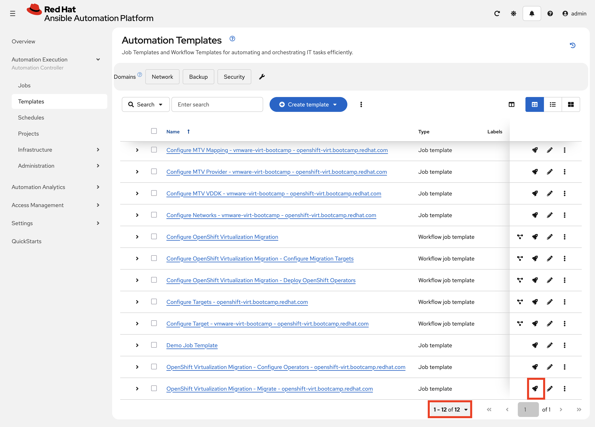
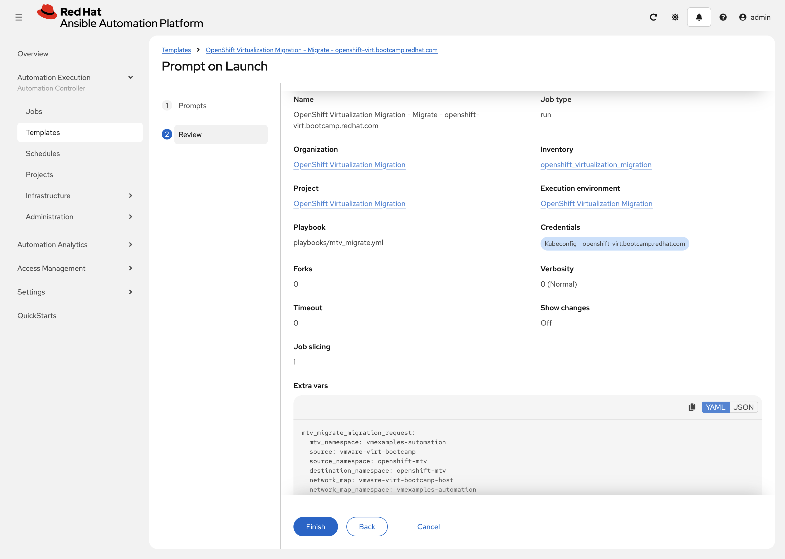
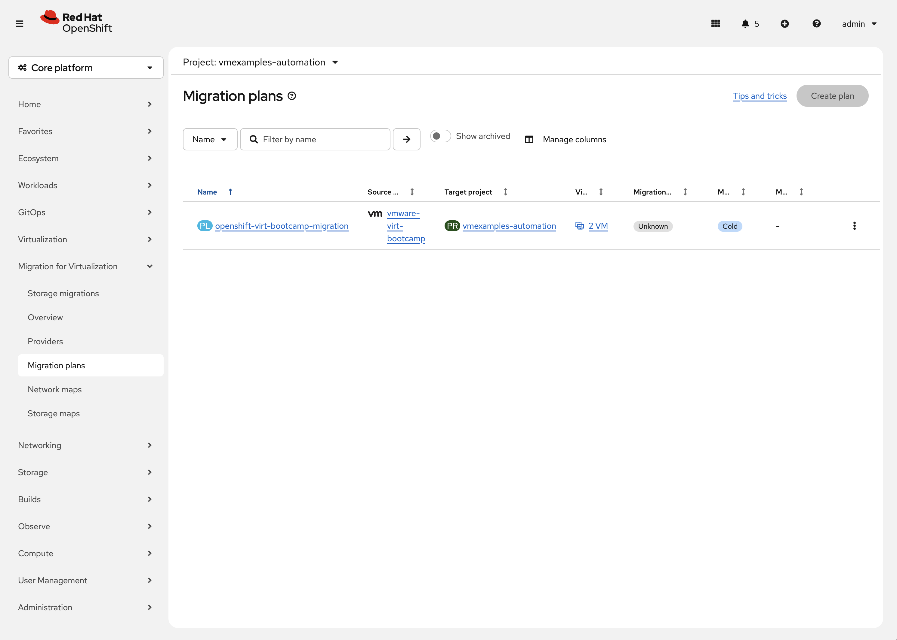
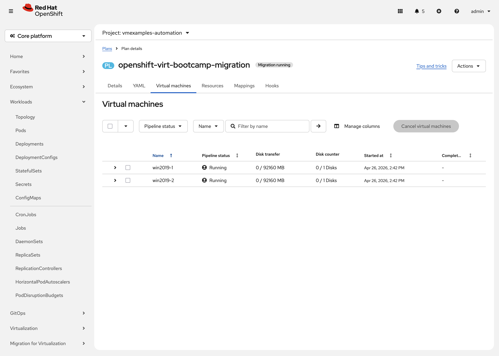
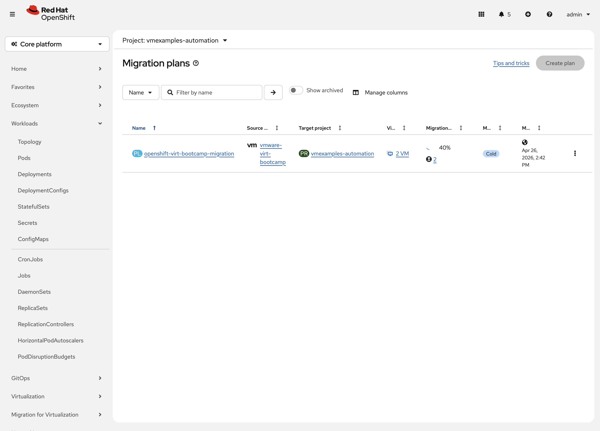
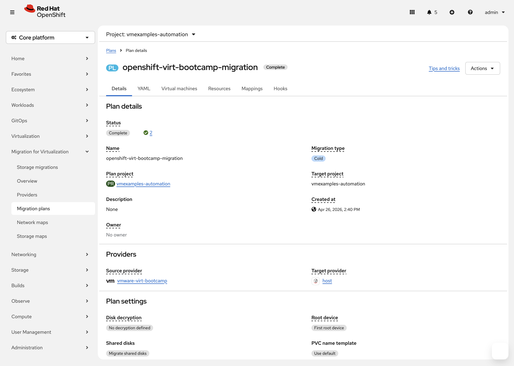
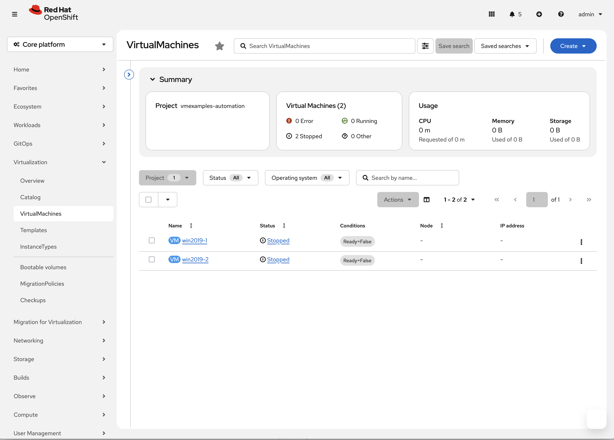

# 03 · Lab 3: run a migration (40 min)

**Goal:** migrate your VMs into `vmexamples-automation` with **one** request to the Migrate
template. You use the three modes you'd use for a real wave:

```text
dry_run: true            → only print the Plan        (review, change freeze safe)
start_migration: false   → create the Plan            (MTV validates it, nothing is copied)
start                    → copy the disks             (the migration itself)
```

## Step 1 · Find your VMs

The shared simulated vCenter shows each participant only their own VMs.

Console: **Migration for Virtualization → Providers → `vmware-virt-bootcamp` → Virtual Machines**.
Note the exact **names** of 1–2 VMs (for example a small web or proxy VM). Names are
**case-sensitive**.

> If a name exists more than once in the inventory, use its **path** instead
> (`path: /<datacenter>/vm/<folder>/<name>`, shown in the VM details).

## Step 2 · Dry run

In **Templates**, find **OpenShift Virtualization Migration - Migrate - openshift-virt.bootcamp.redhat.com**.
There are more than 10 templates, so change the page size if you don't see it.



Launch it with these **Variables** (use your VM names):
```yaml
mtv_migrate_migration_request:
  mtv_namespace: vmexamples-automation       # where the Plan (and by default the VMs) go
  source: vmware-virt-bootcamp               # the source provider (= target name)
  source_namespace: openshift-mtv            # providers live in openshift-mtv
  destination_namespace: openshift-mtv
  plan_name: <userN>-wave1
  dry_run: true
  vms:
    - name: <your VM 1>
    - name: <your VM 2>
```


Open the job output. At the end it **prints the Plan** it would create: source and destination
providers, the maps `vmware-virt-bootcamp-host` in `vmexamples-automation`, the target namespace
and your VMs. Nothing was created on the cluster.

> **Why so few fields?** Most fields default to `mtv_namespace`. The map names default to
> `<source>-host`, which is what Lab 2 created. Only the providers live elsewhere, so
> `source_namespace` and `destination_namespace` point back to `openshift-mtv`.

## Step 3 · Create the Plan

Launch the same template again with the same variables, but replace `dry_run: true` with:
```yaml
  start_migration: false
```
Console: project **vmexamples-automation → Migration for Virtualization → Plans**.



1. The Plan first shows **Validating**. MTV starts a short-lived job (`vddk-validator-…`) that
   checks the VDDK image. The first time on a cluster this can take a few minutes, because an
   image has to be pulled.
2. Then the Plan becomes **Ready**. Open it and look at the **conditions**. You'll probably see
   two warnings that don't block the migration:
   - `NetMapPreservingIPsOnPodNetwork`: some port groups map to the pod network, where static IPs
     can't be kept;
   - `VMMissingGuestIPs`: vCenter reports no guest IPs (the VM is off or VMware Tools isn't running).
3. The **Virtual machines** tab lists your VMs:

   

## Step 4 · Start the migration

On the Plan page click **Start** (or launch the template again with `start_migration: true`).



Watch the VM pipeline: **Initialize → DiskAllocation → ImageConversion → DiskTransfer → …**

## ✅ Checkpoint

In this RHDP environment the expected result is:

| Phase | Expected | Why |
|---|---|---|
| Plan | Ready | providers, maps and VDDK validated |
| Initialize, DiskAllocation | ✅ succeed | MTV created the target disks (PVCs) on your cluster |
| **ImageConversion** | ❌ **fails** | the simulated vCenter can't serve disk data |

**Troubleshoot it like a pro.** Find the exact error by following the same path you'd use on a
real migration:
1. **Plan conditions** (Plan page → Details): which VM failed, and in which phase.
2. **VM pipeline** (Plan → Virtual machines → expand the VM): the failed step and its message.
3. **Conversion pod log:**
   ```bash
   oc get pods -n vmexamples-automation | grep -i -E 'v2v|<your plan name>'
   oc logs -n vmexamples-automation <conversion pod> | grep -i -E 'vixdisklib|error' | tail -5
   ```
   You should find:
   ```text
   VixDiskLib_OpenEx: Failed to start session. Other error encountered: HTTP error response: Service Unavailable
   ```
   VDDK reached the vCenter, but opening the disk returned **503**. The simulated vCenter has no
   disk service, so this is the expected end of the lab.

**In a real environment** the pipeline continues: the disks are copied, virt-v2v converts the
guest, and the VMs appear under **Virtualization → VirtualMachines** (screenshots from the
bootcamp environment):




Something else failed? See [04 · Troubleshooting](04-troubleshooting.md#lab-3).

## From one lab to a 500-VM wave

The same template scales without new tooling:
```yaml
mtv_migrate_migration_request:
  mtv_namespace: app-a
  source: vmware-virt-bootcamp
  source_namespace: openshift-mtv
  destination_namespace: openshift-mtv
  plan_name: app-a-wave3
  folders:
    - path: /<datacenter>/vm/<app-a folder>    # every VM in the folder
  split_plans: true
  vms_per_plan: 20                              # → app-a-wave3-0, -1, -2 …
  start_migration: true
```
Keep this in mind for the final discussion: *plan a 500-VM rollout*.

---
Previous: [02 · Lab 2](02-lab2-prepare-namespace.md) · Next: [04 · Troubleshooting](04-troubleshooting.md) · Back to [README](README.md)
